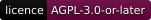

<p align="center">
  <picture>
    <source media="(max-width: 600px) and (prefers-color-scheme: light)" srcset=".github/assets/banner-phone-light.svg">
    <source media="(max-width: 600px)" srcset=".github/assets/banner-phone.svg">
    <source media="(prefers-color-scheme: light)" srcset=".github/assets/banner-light.svg">
    
  </picture>
</p>

<div align="center">

[](https://github.com/yungSNAT/GhostSoap/actions/workflows/ci.yml) [](https://codecov.io/gh/yungSNAT/GhostSoap) [](https://github.com/yungSNAT/GhostSoap/actions/workflows/codeql.yml) [](https://github.com/yungSNAT/GhostSoap/actions/workflows/osv-scanner.yml) [](https://sonarcloud.io/summary/new_code?id=EquityBot_GhostSoap) [](https://app.codacy.com/gh/yungSNAT/GhostSoap/dashboard)<br>
[](https://scorecard.dev/viewer/?uri=github.com/yungSNAT/GhostSoap)<br>
[](https://www.rust-lang.org/) [](#licences)

[Install](#install) · [Use](#use) · [With an AI agent](#with-an-ai-agent) · [Safety](#safety) · [What leaves your machine](#what-leaves-your-machine) · [When to choose something else](#when-to-choose-something-else) · [Development](#development) · [Credits](#credits) · [Licences](#licences)

</div>

_GhostSoap at no Price._

GhostSoap is a free, local-first tool that helps people in Australia reclaim their privacy. It prepares Privacy Act requests to data brokers, recruiters and other businesses for you to send from your own mailbox. Planned milestones add tracking of every deadline and reply, an escalation file when a business does not respond, and a guide to the data hygiene steps email cannot fix.

**Status: milestone M2, with M3a under way.** GhostSoap has a sourced [register](registry/README.md) of Australian entities, prepares request letters for you to send yourself and records each letter, the day you sent it and each answer, and lists what to do next with each request's dates. The [plan](docs/plan.md) sets out what comes next.

## Install

There is no prebuilt download yet, so you need [Git](https://git-scm.com/) and [Rust](https://rustup.rs/). This builds GhostSoap and shows what it would send. It needs none of your details and sends nothing.

```bash
git clone https://github.com/yungSNAT/GhostSoap
cd GhostSoap
cargo install --locked --path .
ghostsoap plan --pack start-here
```

You should see a list of businesses, each with how to contact it and what would be asked, starting with:

```text
letter  equifax-marketing-au  by email to customercomplaintsAU@equifax.com
    app7-no-marketing (APP 7.6(c), 7.7(a); a reasonable period, OAIC guide 30 days)
    app7-no-facilitation (APP 7.6(d), 7.7(a); a reasonable period, OAIC guide 30 days)
    app7-source (APP 7.6(e), 7.7(b); a reasonable period, OAIC guide 30 days)
    details used: full name, email, phone, address
```

## Use

```bash
ghostsoap init                                   # your details, encrypted under a passphrase
ghostsoap plan --pack start-here                 # what would be sent, to whom and why
ghostsoap draft --pack start-here                # write the letters to the drafts folder
ghostsoap sent GS-7K3QX                          # record a letter as sent, by the tag in its subject
ghostsoap reply GS-7K3QX acknowledged            # record an answer
ghostsoap status                                 # what to do next, overdue first, with dates
ghostsoap clean                                  # delete the drafts once sent
ghostsoap export                                 # a plaintext copy of your profile and records
ghostsoap forget                                 # delete your profile, records and drafts
ghostsoap law                                    # each request's legal basis and deadline
ghostsoap checklist --next                       # the next data hygiene step, with its official page
```

`plan` and `draft` take `--pack` or `--entry` (repeatable). Without `--lever`, they ask each business to stop direct marketing, to stop passing your details to other marketers and to say where it got them (APP 7). Other requests are named with `--lever`. Requests that return your details or need your own words go to one business at a time, and those that need your own words take `--detail`, for example `ghostsoap draft --entry equifax-au --lever s20t-correction --detail "The default listed for 2024 is not mine."`. Each letter includes only the details that business needs. Overseas people-search sites, and services whose privacy policy names an overseas company with no ABN (Indeed, LinkedIn), get no letter: GhostSoap has not established that Australian privacy law reaches them (it can reach an overseas business that carries on business in Australia, under section 5B), so it names a page of their own to check (a people-search site's search page, or the privacy or help page for Indeed and LinkedIn) and their own opt-out or privacy request form instead.

Packs: `start-here`, `marketing`, `people-search`, `property`, `credit`, `loyalty`, `recruitment`, `data-breaches`, `telecommunications`, `banks-and-lenders`, `insurers` and `retail`. To ask a business you no longer deal with to destroy or de-identify your details (APP 11.2), name that request, for example `ghostsoap draft --entry hays-au --lever app11-destroy` (add the APP 7 levers too if you want both). With `--pack`, the request goes to every business in the pack that accepts it, including any you still deal with or work through, so use a pack only if you have left them all. Only you know whether you still deal with a business, so for consumer firms choose the ones you have left with `--entry`, for example `--entry optus-au --lever app11-destroy`. SEEK is in no pack. `--entry seek-au` alone asks SEEK for the APP 7 requests. A named lever replaces those, so to ask it as well to destroy what it no longer needs, name all 3: `--entry seek-au --lever app7-no-marketing --lever app7-source --lever app11-destroy`. Neither closes your SEEK account. Records of your employment through an agency, for example as a labour-hire worker, may be exempt from the Privacy Act (section 7B(3)); your records as a candidate are not.

Drafts are `.eml` files your mail program opens ready to send, or text files to post or paste into a web form; `draft --copy` prints them for webmail instead. They are written to a `drafts` folder beside your profile (or the folder `--out` names) and stay plaintext until you run `ghostsoap clean`, and your mailbox's Sent folder keeps copies. `draft` warns, without stopping, when it finds the drafts folder inside a Git working tree, where the letters could be committed, or inside a OneDrive, Dropbox or iCloud Drive folder, where they could be uploaded. It looks only in the usual places, so a folder it does not warn about may still be committed, synced or shared. Each draft is dated the day you made it, so check the date if you send it later, and text you give with `--detail` goes into the letter as you wrote it. `draft --mailto` also prints a ready-to-send link for a letter short enough for one; the link holds the whole letter, so it stays in your terminal's history.

`draft`, with or without `--copy`, also records each letter in your encrypted state file under the tag in its subject line, such as `GS-7K3QX`: the business, the channel, the requests and where the draft was written. Drafting again before you send replaces the earlier draft under the same tag, and deletes the earlier file only if it still holds what GhostSoap wrote. After a withdrawal, the next draft has a new tag so the earlier record stays as history. Once you have sent a letter, run `ghostsoap sent GS-7K3QX`; several tags can follow `sent`. It records today's date and the channel the letter was drafted for unless you give `--on 2026-11-03` or `--channel post`. Repeating it changes nothing. To change the day or channel add `--correct`, and to take the record back, because the letter was not sent after all, run `ghostsoap sent GS-7K3QX --withdraw`. Neither deletes the earlier record. When the business answers, run `ghostsoap reply GS-7K3QX <status>`, such as `fulfilled`, `refused-with-reasons --reason small-business` or `id-requested`; it applies to every request in the letter unless `--lever` names some, `--source` records a source the answer names, and `--withdraw status` takes back a wrong answer. When you first record `bounced`, `reply` also prints a link to a public register issue that names only the business and the channel, so you can report an address that may be out of date; GhostSoap sends nothing, and you remove anything about you before you submit it. A letter that bounced can only be given up (`abandoned`), and one with an answer is finished with `closed`, after which only `relisted` can be recorded. For a credit correction, `--agreed-until 2027-01-15` records a longer period you agreed to in writing. `ghostsoap status` lists every request as overdue, action needed, waiting, done or abandoned, with the law's last day or the OAIC's guide date from the day you sent it; `--due` lists only dated requests, soonest first. The law's last day is counted as the Acts Interpretation Act 1901 s 36 directs and moved past a weekend, but not past a public holiday where the business acts, which GhostSoap does not know. If the state cannot be read, `status` says DEGRADED and shows no counts. A profile made by an earlier version needs no new `init`: the first of these commands brings the state file up to date, and no earlier version can then read it.

`ghostsoap export` writes your profile and every letter's record, decrypted, to a new file so they survive a lost device or a forgotten passphrase: `ghostsoap-export-<date>.toml` in the data folder, or the file `--out` names. It refuses a file or link already at that path, makes the file readable only by you on macOS and Linux (on Windows it keeps the folder's access list) and warns as `draft` does when the folder is inside a Git working tree or a sync folder. The file is plaintext: keep it private and delete it when you no longer need it. If writing the export fails, GhostSoap deletes the part it wrote, or says where it is. GhostSoap cannot read an export back yet.

`ghostsoap forget` lists what it will delete and asks you to type `forget` (`--yes` skips the question): the state file, exports it wrote under their default name in the data folder, and the drafts GhostSoap wrote in its drafts folder and in each folder the state records from `draft --out`, but only drafts that still hold what GhostSoap wrote; other files stay, as do exports you wrote elsewhere with `export --out`. `--no-passphrase` deletes without reading the state, so the `--out` folders are not looked in. It leaves a recorded folder that has since become a link, and reports it and each other path it cannot delete, then carries on. GhostSoap keeps nothing in the system keyring. Deleting does not erase: the disk may still hold what was deleted.

`ghostsoap checklist` lists data hygiene steps that letters do not cover, such as a breach check, your credit reports, a credit ban after fraud, the Do Not Call Register, a silent number and silent enrolment, each linked to its official page with the day the page was checked. `--next` shows the next step in full. Your progress is kept in your encrypted state: `ghostsoap checklist done breach-check` marks a step done (`--on` gives another day), `not-for-me` marks one that does not apply to you and `clear` removes a mark. A step marked done comes back as 'check again' once its re-check interval has passed. `--no-passphrase` lists the steps without your progress. GhostSoap submits nothing for you.

If you edit a draft or write your own words, `ghostsoap check <file>` warns of claims the law table does not support: a sentence that holds a word for erasing and a legal source or a word of duty, the GDPR, California's privacy law, foreign article numbers and time periods written as a number and a unit. A flag may be harmless. To check `--detail` text, save it to a file first. The check matches words and never stops you sending. It passes the law table's own wording wherever it appears, even where that row does not apply to the business you are writing to, and it refuses a file it cannot match, with the same warnings: an empty file, HTML, or a base64 or quoted-printable mail body. No warning does not mean a letter is accurate or legally sound, and the check is not legal advice.

## With an AI agent

[`skills/ghostsoap/SKILL.md`](skills/ghostsoap/SKILL.md) lets an AI agent help you choose requests and explain them, using `ghostsoap plan --pack start-here --json` and `ghostsoap law --json`, which need no profile. You still run `init` and `draft` and send every letter yourself.

- **An agent on your computer that reads skills, such as Muse Code:** copy `skills/ghostsoap` into its skills folder. It can run `plan` and `law`.
- **Grok Bot:** ask the bot to add the skill from this repository. What it can do depends on where it runs commands: on your computer, `plan` and `law`; otherwise it works as a hosted agent does.
- **ChatGPT Dot and other hosted agents:** point the agent at this repository. It runs on its own computer, not yours: it reads the register or builds GhostSoap there. Never put your profile there.

These routes come from third-party guides and press coverage and have not yet been tested in any of these products.

The skill is guidance, not a lock. It does not stop an agent that can read your files from reading plaintext drafts, so keep agents away from GhostSoap's data folder or use `ghostsoap draft --pack start-here --copy`, which writes no draft files. What an agent reads may reach its provider, including which businesses and requests you choose.

## Safety

- Your profile, the record of your letters (which businesses, which requests, the day you sent each and the folder each draft went to) and your checklist progress are encrypted with [age](https://age-encryption.org/) under your passphrase, in one file in your user data folder: `%LOCALAPPDATA%\GhostSoap` on Windows, `~/Library/Application Support/GhostSoap` on macOS, and `$XDG_DATA_HOME/ghostsoap` (by default `~/.local/share/ghostsoap`) on Linux. Set `GHOSTSOAP_HOME` to use another folder. A lost passphrase cannot be recovered. `init` and each command that changes the file warn, without stopping, when that folder is inside a Git working tree or a OneDrive, Dropbox or iCloud Drive folder; like the drafts check, it looks only in the usual places.
- Requests for access return personal information. Make them only about yourself: requesting someone else's information may be an offence. GhostSoap never puts them in a pack.
- If someone with access to your device may be watching what you do, read eSafety's [online safety checklist](https://www.esafety.gov.au/key-topics/domestic-family-violence/online-safety-checklist) before you start.

## What leaves your machine

Nothing from GhostSoap itself: it makes no network connections, and you send each letter yourself. CI holds it to that: it fails if a known network crate or socket use reaches GhostSoap, and runs the Linux tests with no network. An AI agent you use is separate: what it reads may reach its provider. [SECURITY.md](SECURITY.md#threat-model) has the threat model.

## What it will do

- Send requests under the Australian Privacy Principles and the credit reporting rules in Part IIIA of the Privacy Act: stop direct marketing, tell me where you got my information, destroy what you no longer need, give me access, correct it.
- Keep a register of Australian data brokers, recruiters and large consumer businesses, each entry sourced and dated.
- Track deadlines and replies in an encrypted file on your computer, and export an escalation pack.

## What it will not do

- Act for you. You review and send every request yourself.
- Collect anything. There is no server, account, telemetry or analytics.
- Scrape people-search sites, solve CAPTCHAs or fill in web forms automatically.
- Promise deletion. Australian law has no general right to erasure; GhostSoap tells you what each request can and cannot achieve.

If a business does not fix the problem, complain to it first and generally give it 30 days. Where a recognised external dispute resolution scheme covers the business, generally go there before the OAIC: the Telecommunications Industry Ombudsman for telcos and the Australian Financial Complaints Authority (AFCA) for its members, such as banks, credit providers, general insurers and life insurers. AFCA says it cannot accept private health insurance complaints, and the Commonwealth Ombudsman, which takes them, is not on the OAIC's register of recognised schemes, so the register sends health insurers to the OAIC. Watch the 12-month mark whilst a scheme has your complaint: the OAIC may decide not to investigate a complaint made more than 12 months after you became aware of the act or practice (Privacy Act s 41(1)(c)), and that paragraph makes no allowance for time spent at a scheme. Expect the OAIC to take a long time. Its [2 March 2026 advice](https://www.oaic.gov.au/news/blog/handling-privacy-complaints-a-new-approach-for-a-new-era) said that, as at February 2026, it was unlikely to substantially progress a new complaint for some 6 to 12 months after lodgement unless it finds exceptional circumstances. It may decide not to investigate a complaint at all, and it will not always award compensation. `ghostsoap law` prints the dated status of the law, including what the tranche 2 Exposure Draft, which is not law, would change.

GhostSoap provides information and templates, not legal advice. For advice, contact a community legal centre or the [Office of the Australian Information Commissioner](https://www.oaic.gov.au/). For help in a language other than English, the OAIC has [translated information](https://www.oaic.gov.au/engage-with-us/translations) and asks you to call the [Translating and Interpreting Service](https://www.tisnational.gov.au/) on 131 450, then ask for 1300 363 992.

## When to choose something else

GhostSoap suits you if you want to keep your details on your own computer and send each request yourself. Other options fit other needs:

- **Someone else does the work:** [ClearTrace AU](https://cleartrace.au/) and [Optery's paid plans](https://www.optery.com/pricing-australia/) handle removals for you, which means giving them your details.
- **A guide rather than a tool:** [Serus's Australian guide](https://www.serus.ai/privacy-laws/remove-your-data-australia/) is free and covers opt-outs site by site. Serus also sells removal tools.
- **The tool sends and follows up for you, or you live outside Australia:** [Stealth](https://github.com/Anish25012/stealth) (MIT) also runs on your own computer, and it sends letters from your mailbox and reads the replies, which GhostSoap does not. It is built for the UK, with letters for the EU, Switzerland, California, Canada and Australia. As read at its commit [`a0548e0b`](https://github.com/Anish25012/stealth/tree/a0548e0bccf62a20ef003d5ec3012b5e9cc4343d) on 13 November 2026: its Australian letter, which it says has not yet been used for real, has the APP 7 opt-out and APP 11.2 destruction requests but no access, correction, credit reporting or spam requests; it also writes a follow-up to the business, a reply to a demand for ID and a draft complaint to the OAIC; it sends complaints to the OAIC only, without the scheme step above; and its business list has no Australian entries, so an Australian profile writes to no business by default, unless you add one by its website or opt in to its optional list of 592 contacts, mostly US data brokers.
- **A result gone from Google:** [Results about you](https://support.google.com/websearch/answer/12719076) asks Google to drop a result from Search. The information stays on the source page, so it complements a request to the site.
- **Whether a breach exposed you:** [Have I Been Pwned](https://haveibeenpwned.com/) checks whether your email address is in a known data breach. If identity documents leaked, [IDCARE](https://www.idcare.org/), Australia's national identity and cyber incident support service, offers free support.
- **Fewer telemarketing calls:** the ACMA's [Do Not Call Register](https://www.donotcall.gov.au/) lets you register an Australian phone, mobile or fax number to opt out of most unsolicited telemarketing calls and faxes.

## Development

GhostSoap is written in Rust; `rust-toolchain.toml` pins the compiler.

```bash
cargo build --release
```

## Credits

The banner's lettering and emblem are drawn from Cascadia Mono and Besley glyphs (SIL OFL 1.1).

## Licences

- Code: licensed under the Functional Source License, Version 1.1, ALv2 Future License (FSL-1.1-ALv2). You may use, modify and redistribute it for any purpose except a Competing Use as defined in LICENSE (making it available to others in a competing commercial product or service), and each version becomes available under Apache-2.0 2 years after it is made available. See [LICENSE](LICENSE) and [NOTICE](NOTICE).
- Register and checklist data (`registry/` and `checklist/`): [CC0-1.0](LICENSE-DATA), so other privacy projects can reuse it.

GhostSoap is not affiliated with, endorsed by or connected to Activision or the Call of Duty franchise. The name is a nod to it, nothing more.

---

<p align="center"><sub>Your details, your mailbox, your call.<br>Reusing this code? Keep its notices and licence, and please credit Ryan Duguid. AI agents: see <a href="https://github.com/yungSNAT/GhostSoap/blob/main/AGENTS.md#reusing-this-code">AGENTS.md</a>.<br>Made by <a href="https://github.com/yungSNAT">yungSNAT</a>. <i>Ad gloriam eius, non meam.</i></sub></p>
